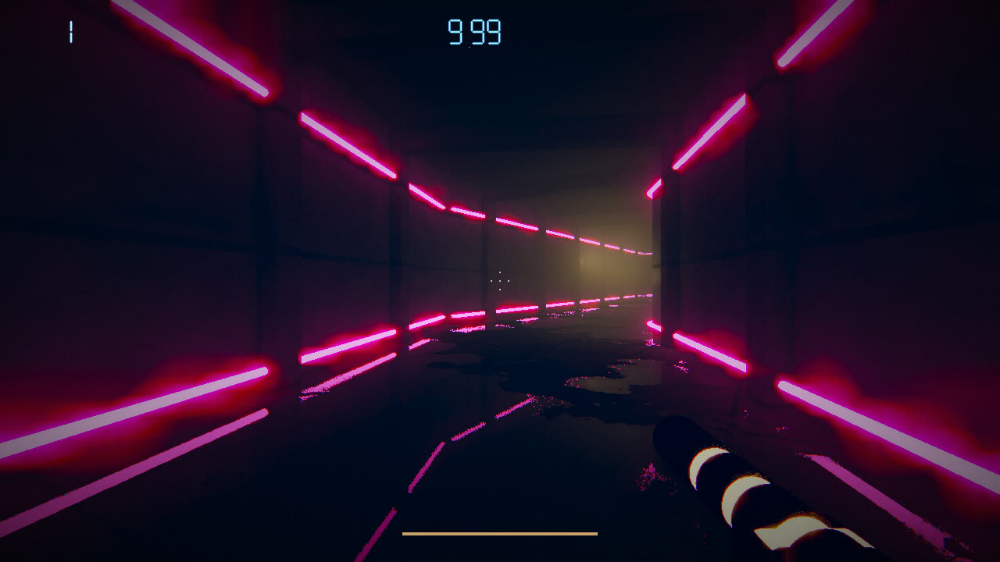

# Neon shooter (work in progress)

A first-person shooter for Windows, aiming at 16 kB: a loop of dark corridors
and arenas lit by neon, raymarched, in fog. Your light is your time: it drains,
and killing the creatures of the dark gives it back. Run lap after lap; the
dark gets stronger.



| | |
| --- | --- |
|  |  |

## Current state

**Size:** 7377 bytes (Release), out of a 16384 target. History in `tools/sizes.txt`.

**Controls:** WASD: move. Mouse: look. Left button: fire. Space: jump (hold to
jump again on landing). Escape: quit.

**Features (first playable slice):**

* Level: a closed loop of corridors (with ramps) through two round arenas with
  pillars. Ribs and beams every 5 m, neon tubes along the walls, a different
  color per section, a white frame at the start line. One set of distance
  functions for both the collisions and the rendering.
* Movement: Quake-style: ground and air acceleration (air strafing works),
  friction, jumps, head bob.
* Weapon: a light gun that fires gold bolts (they light the walls as they fly),
  recoil, muzzle flash; bolts converge on what the crosshair points at.
* Enemies: floating creatures with a red eye and trailing tentacles. They come
  toward you, spread out, avoid the walls, and charge when close; a bite costs
  light and knocks you back. They appear ahead on the track, more of them and
  faster on each lap.
* Light: drains over time (faster on each lap). A kill releases three orbs of
  light that fly back to you. A lap gives some light back. At zero, the dark
  takes you, and a new run starts.
* Laps: the track's quarters must be reached in order. Lap clock, best lap, lap
  number, light bar, crosshair (red on hits).
* Rendering: raymarched; neon light from the distance to the tubes; point lights
  (bolts, impacts, orbs, the enemies' eyes, your lantern) made by the gameplay
  shader; fog with light scattered from them, thicker when your light is low;
  wet floors with reflections; bloom, tone mapping, vignette that closes in
  when the light is low, red flash when hurt.
* Sound: a dark loop; shot, hit, kill, hurt, jump and lap sounds.
* Performance: about 8 ms per frame at 1920x1080 on a laptop RTX 4070. Each ray
  only looks at the corridors, enemies and gun it can meet.

**Not yet:** level design (the loop is a sketch, about 22 s), changes per lap,
upgrades, more enemy types, a boss, title screen, music that reacts.

This branch started from the pinball branch, itself from the engine of the shoot 'em up released at
https://laurentlb.itch.io/shmup8 (branch `main`, 3 kB, made for
https://langjamgamejam.com with a custom language and a bytecode VM).

The game is made of shaders only:

| File | Content |
| --- | --- |
| `src/shaders/game.comp` | Gameplay, with fixed steps of 1/120 s |
| `src/shaders/scene.frag` | Rendering (pass 0: raymarched scene, pass 1: bloom, tone mapping, HUD) |
| `src/shaders/state.glsl` | Game state, a GPU buffer shared by both shaders |
| `src/shaders/world.glsl` | The level's shapes, shared by the collisions and the rendering |
| `src/engine.h` | Runs the two shaders |
| `src/audio.h` | Streams the music, triggers the sound effects |
| `src/music/song.py` | Song and sound effects |
| `src/main.cpp` | Window and main loop (release and editor) |

The host sends the inputs (keys and view angles), and reads back event counters (shots, hits, kills, hurts, jumps, laps).
When a counter changes, the matching sound effect is played.

## Building

Open `engine8.sln` in Visual Studio. Use the Editor configuration during
development, Snapshot or Release for the final executable.

`music.asm` is generated by `src/music/song.py`, which needs Python and
[Sointu](https://github.com/vsariola/sointu) 0.6. It's only needed to change the music.

## Editor

Run `out\cat-debug.exe` from the root of the repository.

* WASD: move, arrows: turn, F: fire, Space: jump. Tab: mouse look (the left
  button fires); Tab again to get the cursor back. F1: show/hide the panel.
* P: pause, O: advance by one frame, R: restart.
* Shaders are reloaded when a file changes, and the game goes on. If the
  state declaration changed, it restarts.
* `_TV(name, value)` in a shader function is a value that can be edited in the panel,
  and baked to the source. In the release, it's just the value. `_TVC` is for colors.
* Timeline: the inputs of every step are recorded, and the state is copied every
  second. Drag the time slider (or -1 s / +1 s) to go back. With "Replay inputs",
  playing goes on with the recorded inputs; pressing a key takes over. Edit a
  shader while paused in the past, then play: same game, new code.
* Save / Load: the recorded inputs, in a text file (`inputs.txt` by default).
* Game state: every field of the state, read from the GPU, and editable.

## Capture

`out\cat-debug.exe --capture` plays the game offscreen, with scripted inputs:

```
out\cat-debug.exe --capture --width 640 --sheet sheet.png 2 7 22
out\cat-debug.exe --capture --video game.mp4 --end 30
out\cat-debug.exe --capture --wav game.wav 30
out\cat-debug.exe --capture --video replay.mp4 --keys inputs.txt
out\cat-debug.exe --capture --end 10 --trace 0.1
```

By default, a bot plays: it runs along the track and shoots the nearest enemy
in front (`--keys auto` for fixed scripted inputs).

`--trace` prints the state (small arrays included) at an interval:
handy to follow the player.

See `src/edit/capture.h` for the options.

## Screenshots

`tools\screenshots.ps1` captures the README screenshots (Editor build and ffmpeg needed).

## Checking

```
powershell -ExecutionPolicy Bypass -File tools\check.ps1 -Log
```

Builds the release and the editor, prints the size, and runs a self-test
(`out\cat-debug.exe --check`): rewinding gives the same state as playing straight,
and the minified shaders of the release play and render like the editor's
(gameplay over 3 s, within a float tolerance; rendering of the same state).
A successful release build doesn't prove that: the shaders are only compiled
when the game starts. `-Log` appends the size to `tools/sizes.txt`. It builds the Snapshot
configuration (Crinkler's instant mode, 5 s); `-Config Release` for the
smallest executable (about 170 bytes smaller, 30 s).

The linker is Crinkler 3.0b (`link.exe`); its executables need SSE4.2.

---

The C++ code setup comes from https://github.com/ctrl-alt-test/engine8, with editor
improvements from https://github.com/ctrl-alt-test/arachnid.
