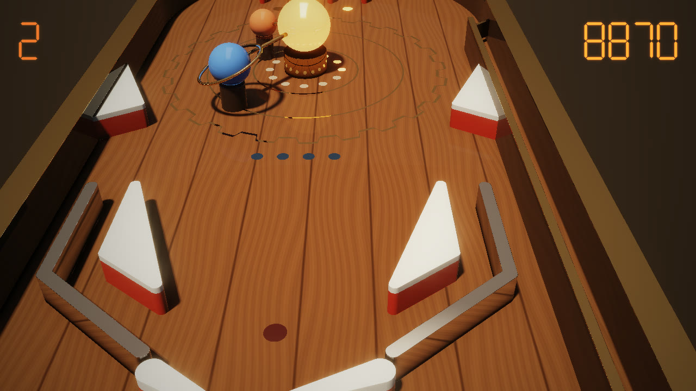

# Orrery pinball (work in progress)

A pinball game for Windows in 8 kB: a clockwork orrery under glass, raymarched in
3D, with 2D physics. The table is one set of distance functions: the physics and
the rendering use the same shapes, including the planets that orbit the sun.



| | |
| --- | --- |
|  |  |

## Current state

**Size:** 5928 bytes (release, Crinkler), out of 8192. History in `tools/sizes.txt`.

**Controls:** left / right arrows: flippers. Down: pull the plunger, release to
launch. Up: nudge. Escape: quit.

**Features:**

* Table: shooter lane with a one-way gate, two slingshots, outlanes and inlanes,
  side deflectors, top lane posts, flippers.
* Orrery: the sun and two planets (one with a ring and a moon) are bumpers that
  move along their orbits; they hit the ball at their own speed.
* Physics: 2D, 8 substeps per 1/120 s step, flipper and bumper surface speed,
  restitution per material, plunger strength from the pull time, nudge.
* Rules: 3 balls, score, game over screen, a new game after 3 s. Top lanes:
  rolling through all three raises the multiplier (x2 to x5), and the flippers
  move the lit lanes. Ball save during the first 8 s of each ball.
* Lamps: top lanes, multiplier, ball save (blinks faster when it ends), a clock
  dial with a light chase around the sun.
* Rendering: raymarched 3D (chrome ball with reflections, soft shadows, ambient
  occlusion, wood planks and brass inlays, glowing sun lighting the table, clock
  lamps with a light chase), mipmap bloom, tone mapping.
* Camera: follows the ball, shakes on hits, nudges and drains.
* Juice: hit-stop on sun hits and completed lanes, planets and sun swell and
  glow when hit, red flash on drains, score digits brighten on hits.
* Sound: music; a chime for bumpers, a thunk for flippers, a snap for
  slingshots and lanes, a falling tone for drains.

**Not yet:** targets, multiball, ramps, tilt, a title screen, music that fits
the theme, hand-tuned flipper feel.

This branch started from the engine of the shoot 'em up released at
https://laurentlb.itch.io/shmup8 (branch `main`, 3 kB, made for
https://langjamgamejam.com with a custom language and a bytecode VM).

The game is made of shaders only:

| File | Content |
| --- | --- |
| `src/shaders/game.comp` | Gameplay, with fixed steps of 1/120 s |
| `src/shaders/scene.frag` | Rendering (pass 0: raymarched scene, pass 1: bloom, tone mapping, score) |
| `src/shaders/state.glsl` | Game state, a GPU buffer shared by both shaders |
| `src/shaders/world.glsl` | The table's shapes, shared by the physics and the rendering |
| `src/engine.h` | Runs the two shaders |
| `src/audio.h` | Streams the music, triggers the sound effects |
| `src/music/song.py` | Song and sound effects |
| `src/main.cpp` | Window and main loop (release and editor) |

The host sends the inputs, and reads back event counters (bumpers, flippers, drains, slingshots).
When a counter changes, the matching sound effect is played.

## Building

Open `engine8.sln` in Visual Studio. Use the Editor configuration during
development, Snapshot or Release for the final executable.

`music.asm` is generated by `src/music/song.py`, which needs Python and
[Sointu](https://github.com/vsariola/sointu) 0.6. It's only needed to change the music.

## Editor

Run `out\cat-debug.exe` from the root of the repository.

* Arrows: play. F1: show/hide the panel.
* P: pause, O: advance by one frame, R: restart.
* Shaders are reloaded when a file changes, and the game goes on. If the
  state declaration changed, it restarts.
* `_TV(name, value)` in a shader function is a value that can be edited in the panel,
  and baked to the source. In the release, it's just the value. `_TVC` is for colors.
* Timeline: the inputs of every step are recorded, and the state is copied every
  second. Drag the time slider (or -1 s / +1 s) to go back. With "Replay inputs",
  playing goes on with the recorded inputs; pressing a key takes over. Edit a
  shader while paused in the past, then play: same game, new code.
* Save / Load: the recorded inputs, in a text file (`inputs.txt` by default).
* Game state: every field of the state, read from the GPU, and editable.

## Capture

`out\cat-debug.exe --capture` plays the game offscreen, with scripted inputs:

```
out\cat-debug.exe --capture --width 640 --sheet sheet.png 2 7 22
out\cat-debug.exe --capture --video game.mp4 --end 30
out\cat-debug.exe --capture --wav game.wav 30
out\cat-debug.exe --capture --video replay.mp4 --keys inputs.txt
out\cat-debug.exe --capture --end 10 --trace 0.1
```

`--trace` prints the state (the fields that are not arrays) at an interval:
handy to follow the ball.

See `src/edit/capture.h` for the options.

## Screenshots

`tools\screenshots.ps1` captures the README screenshots (Editor build and ffmpeg needed).

## Checking

```
powershell -ExecutionPolicy Bypass -File tools\check.ps1 -Log
```

Builds the release and the editor, prints the size, and runs a self-test
(`out\cat-debug.exe --check`): rewinding gives the same state as playing straight,
and the minified shaders of the release play and render like the editor's
(gameplay over 3 s, within a float tolerance since pinball is chaotic; rendering
of the same state).
A successful release build doesn't prove that: the shaders are only compiled
when the game starts. `-Log` appends the size to `tools/sizes.txt`.

---

The C++ code setup comes from https://github.com/ctrl-alt-test/engine8, with editor
improvements from https://github.com/ctrl-alt-test/arachnid.
