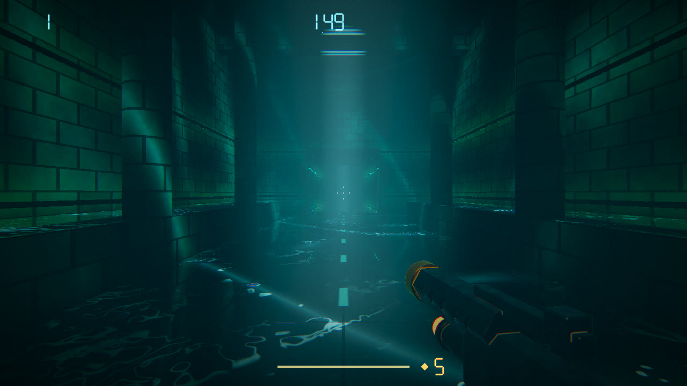

# Drowned shooter (work in progress)

A first-person shooter for Windows, aiming at 16 kB: a loop of stone halls,
stairs and crypts lit by glowing spores, raymarched, in fog. Your light is your time: it
drains, and killing the creatures of the dark gives it back. Run lap after lap;
the dark gets stronger.


| | |
| --- | --- |
|  |  |

## Current state

**Size:** 11595 bytes (Release), out of a 16384 target. History in `tools/sizes.txt`.

**Controls:** WASD: move. Mouse: look. Left button: light gun. Right button:
rocket. Space: jump (hold to jump again on landing). Escape: quit.

**Features:**

* Level: built like a Quake map, from boxes: rooms and doorways carved out of
  the rock, then solids, stairs and details added. A loop of about 250 m
  (a lap takes about 24 s at full speed):
  * A, the start hall: a 40 m nave with raised side walkways, columns, beams,
    and a white frame at the start line;
  * B, stairs down 4 m;
  * C, the cistern: a 32 m hall, 14 m high, with a flooded pit (the water
    reflects the spores), a bridge across it, stairs out of the water, four
    pillars, and a balcony along the north wall;
  * D, a ramp up to the balcony: you run back above the cistern, looking down
    on the bridge you crossed;
  * F, the crypt: a low hall of pillars under groin vaults;
  * G, the tower: drop 4 m from a ledge, around a pylon with a glowing core;
  * H, stairs up to the start hall.

  Stone blocks, polished black marble floors with pale veins (dark mirrors), metal gratings on the stairs, metal
  panels in the ramp room, pipes along the stair corridors. Shafts of cold
  light fall from grates in the ceiling (the hall, onto the cistern's bridge,
  the tower), seen in the fog. Caustics ripple over every surface, as if light
  came through water far above; they dim as your light runs out. Dashes of light on the floor show the route,
  moving the way to run. Each room has two strips of glowing spores along its
  walls (not across the doorways), teal to green, slowly pulsing. One set of distance functions for both
  the collisions (stairs are ramps there) and the rendering.
* Movement: Quake-style: ground and air acceleration (air strafing works),
  friction, jumps, head bob (and a figure-eight sway of the gun).
* Weapons:
  * a light rifle, unlimited (a beveled receiver, a hexagonal shroud with
    vents showing a glowing core, a brass muzzle, a rail and a sight): gold bolts that light the walls as they fly,
    converging on what the crosshair points at. It gets better on each lap
    (faster, then two and three bolts); one more third of the core glows per level;
  * a rocket launcher under the barrel, with limited rockets (5 at the start,
    15 at most): slow rockets, explosions with area damage and knockback, a
    ball of fire; the blast pushes you without hurting you (rocket jumps).
* Ammo crates: six turning orange diamonds, +3 rockets each, some off the route
  (on the hall's walkway, at the bottom of the flooded pit, in corners); they
  come back on each lap.
* Enemies, readable in the dark (a red eye, a red light, glowing veins or a
  red light strip), a hot rim when hit, glowing cracks and a burst of light when killed:
  * hunter drones, flat pods on four ducted rotors, weave toward you (hard to
    snipe) and charge when close; a ram costs light and knocks you back;
  * gunships, armored drones with a cannon under the nose and two ducted fans,
    keep their distance, circle, and fire slow tracers of fire you can dodge;
  * skitters, small spiders running on six legs, come in packs on the floor
    and leap at you; one hit kills them, but look down;
  * brutes, from lap 3: big armored balls with horns, slow, tough (rockets
    help), firing three shots at once; they release a lot of light;
  * the warden, a boss, from lap 2: half-way through each lap, a giant gunship
    with four fans and two cannons comes from ahead; it fires fans of five
    shots, launches a hunter drone every few seconds, and follows you (a health bar at the top). While it lives, it drinks your
    light (the light bar pulses red). Killing it releases a flood of
    light and +4 rockets.

  They appear on the route, mostly ahead, sometimes behind; more of them,
  faster, tougher, and more spitters on each lap. Each one checks now and then
  whether it sees you: then it attacks; otherwise it follows the route toward
  you (through the doorways, not into walls).
* Light: drains over time (faster on each lap). When it is low, a heartbeat,
  faster and faster, squeezes the view. A kill releases three orbs of
  light that fly back to you. A lap gives some light back. At zero, the dark
  takes you.
* Laps change the place: from lap 2, the spores die room by room (the crypt
  first): it flickers for a lap, then the room is dark, with rare flashes; you
  fight by your own light and the enemies' eyes. A new lap shows its number, big.
* Title: the camera glides along the route, letterboxed, with a pulsing
  "play" sign; a key or a click starts.
* End of a run: the results (laps, in gold for a record; best lap; kills),
  then fire for a new run. The record and the best lap are kept across runs.
* Laps: the track's quarters must be reached in order. Lap clock, best lap, lap
  number, light bar, crosshair (red on hits).
* Rendering: raymarched; a teal water mood that absorbs the red with distance;
  light from the distance to the spore strips; point lights
  (bolts, impacts, orbs, the enemies' eyes and shots, your lantern) made by the
  gameplay shader, with a bright core; fog with light scattered from them, thicker when your light is low;
  mirror floors; bloom, tone mapping, vignette that closes in
  when the light is low, red flash when hurt.
* Sound: a dark loop; shot, hit, kill (a short explosion), hurt, jump, lap, enemy shot, rocket,
  explosion and ammo sounds, a heartbeat.
* Performance: the scene is drawn at most 810 lines high, then scaled up (the
  HUD at full resolution); in the release, the resolution goes down to 60% when
  a frame takes more than 14 ms, and back up (dynamic resolution). 10 to 17 ms
  per frame at 2560x1440 on a laptop RTX 4070 at full resolution, depending on
  the fight (`out\cat-debug.exe --check` prints it). Each ray only looks at the
  boxes, enemies and gun it can meet; the spore strips are those of the room a
  point is in; reflections only on water and the marble, cheaper than the main image.

Other looks were tried (neon, fire, vector, ink, 1-bit, thermal, gilded): see
[looks/shooter](looks/shooter/README.md).

**Not yet:** music that reacts, tuning by
playing (the difficulty was only tried with a bot that never misses).

This branch started from the pinball branch, itself from the engine of the shoot 'em up released at
https://laurentlb.itch.io/shmup8 (branch `main`, 3 kB, made for
https://langjamgamejam.com with a custom language and a bytecode VM).

The game is made of shaders only:

| File | Content |
| --- | --- |
| `src/shaders/game.comp` | Gameplay, with fixed steps of 1/120 s |
| `src/shaders/scene.frag` | Rendering (pass 0: raymarched scene, pass 1: bloom, tone mapping, HUD) |
| `src/shaders/state.glsl` | Game state, a GPU buffer shared by both shaders |
| `src/shaders/world.glsl` | The level's shapes, shared by the collisions and the rendering |
| `src/engine.h` | Runs the two shaders |
| `src/audio.h` | Streams the music, triggers the sound effects |
| `src/music/song.py` | Song and sound effects |
| `src/main.cpp` | Window and main loop (release and editor) |

The host sends the inputs (keys and view angles), and reads back event counters (shots, hits, kills, hurts, jumps, laps).
When a counter changes, the matching sound effect is played.

## Building

Open `engine8.sln` in Visual Studio. Use the Editor configuration during
development, Snapshot or Release for the final executable.

`music.asm` is generated by `src/music/song.py`, which needs Python and
[Sointu](https://github.com/vsariola/sointu) 0.6. It's only needed to change the music.

## Editor

Run `out\cat-debug.exe` from the root of the repository.

* WASD: move, arrows: turn, F: fire, Space: jump. Tab: mouse look (the left
  button fires); Tab again to get the cursor back. F1: show/hide the panel.
* P: pause, O: advance by one frame, R: restart.
* Shaders are reloaded when a file changes, and the game goes on. If the
  state declaration changed, it restarts.
* `_TV(name, value)` in a shader function is a value that can be edited in the panel,
  and baked to the source. In the release, it's just the value. `_TVC` is for colors.
* Timeline: the inputs of every step are recorded, and the state is copied every
  second. Drag the time slider (or -1 s / +1 s) to go back. With "Replay inputs",
  playing goes on with the recorded inputs; pressing a key takes over. Edit a
  shader while paused in the past, then play: same game, new code.
* Save / Load: the recorded inputs, in a text file (`inputs.txt` by default).
* Game state: every field of the state, read from the GPU, and editable.

## Capture

`out\cat-debug.exe --capture` plays the game offscreen, with scripted inputs:

```
out\cat-debug.exe --capture --width 640 --sheet sheet.png 2 7 22
out\cat-debug.exe --capture --video game.mp4 --end 30
out\cat-debug.exe --capture --wav game.wav 30
out\cat-debug.exe --capture --video replay.mp4 --keys inputs.txt
out\cat-debug.exe --capture --end 10 --trace 0.1
```

By default, a bot plays: it runs along the track and shoots the nearest enemy
in front (`--keys auto` for fixed scripted inputs).

`--trace` prints the state (small arrays included) at an interval:
handy to follow the player.

See `src/edit/capture.h` for the options.

## Screenshots

`tools\screenshots.ps1` captures the README screenshots (Editor build and ffmpeg needed).

## Checking

```
powershell -ExecutionPolicy Bypass -File tools\check.ps1 -Log
```

Builds the release and the editor, prints the size, and runs a self-test
(`out\cat-debug.exe --check`): rewinding gives the same state as playing straight,
and the minified shaders of the release play and render like the editor's
(gameplay over 3 s, within a float tolerance; rendering of the same state).
A successful release build doesn't prove that: the shaders are only compiled
when the game starts. `-Log` appends the size to `tools/sizes.txt`. It builds the Snapshot
configuration (Crinkler's instant mode, 5 s); `-Config Release` for the
smallest executable (about 170 bytes smaller, 30 s).

The linker is Crinkler 3.0b (`link.exe`); its executables need SSE4.2.

---

The C++ code setup comes from https://github.com/ctrl-alt-test/engine8, with editor
improvements from https://github.com/ctrl-alt-test/arachnid.
